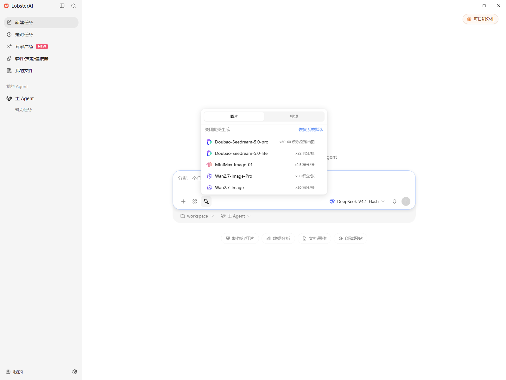
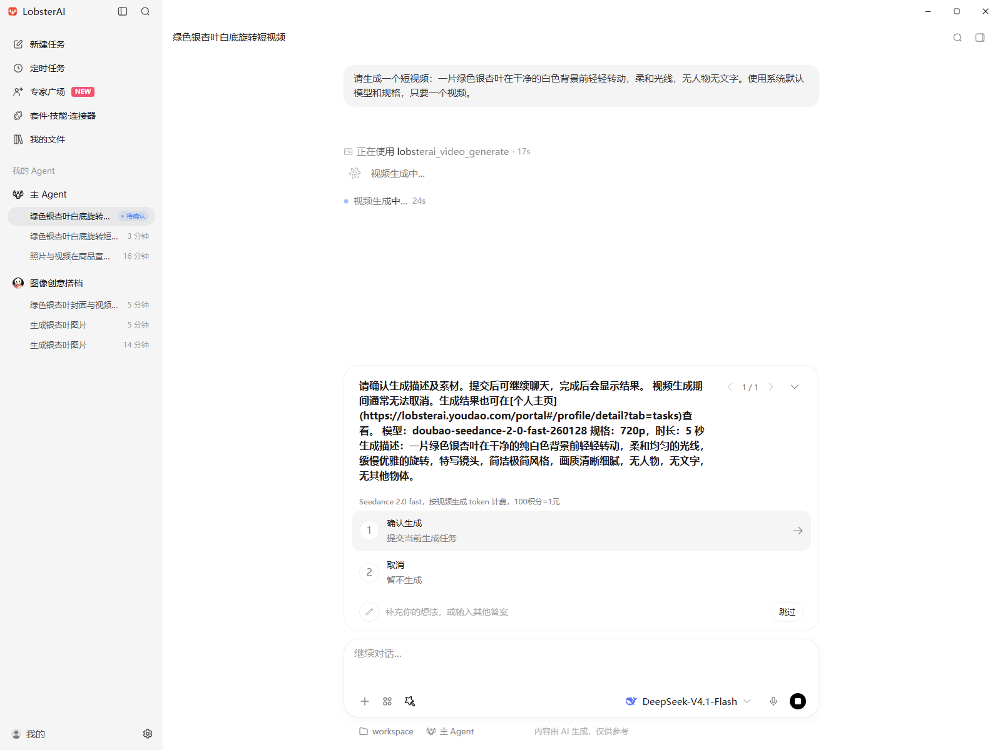

# 默认图片/视频策略验收（2026-10-16）

编译后的开发客户端已完成本地集成验收，真实图片和视频生成均成功，视频取消确认没有创建媒体任务。随后连接真实测试服务验证动态配置，用户已确认客户端体验。

本文保留可公开复核的行为和截图。原始账号、数据库连接信息、认证文件、账务、任务标识、日志与生成文件保留在本地忽略的验收目录，不随代码发布。

## 环境和范围

- 客户端以 release/2026.10.13 为基线，使用独立 userData、工作目录和 OpenClaw 运行时副本。
- 首轮验收使用 test profile 本地服务和真实测试数据库、Redis、供应商及扣费链路。持久层保留生产 MyBatis 配置，mapUnderscoreToCamelCase=false。
- 本地启动器仅替代 Overmind 的传输，调用真实配置监听器、解析器及策略服务；关闭无关定时任务，只处理专用测试账号的媒体恢复任务。
- Electron 通过 Playwright/CDP 操作，未使用 computer-use 或系统键鼠。后续人工体验连接真实测试服务。
- 没有新增数据库表或 DDL。原始测试数据和运行证据均保留。

## 用例结果

| 场景 | 结果 |
|---|---|
| 配置缺失、无 capability、匿名请求 | 缺失配置关闭默认；无 capability 不下发；匿名返回 401 |
| 动态配置 | 启用后下发两个可见模型；无效更新保留最近有效值；0% 灰度关闭；不可见模型不下发 |
| 新账户默认 | 使用 Seedream 5.0 lite 和 Seedance 2.0 fast；偏好为 inherit，不写成手选模型 |
| 关闭/恢复 | 图片 off 跨刷新保留，不影响视频；恢复系统默认后重新 inherit |
| 手选兼容 | 手选模型跨刷新和策略关闭仍保留；旧键为空、单种/双种选择、坏数据迁移由自动化测试覆盖 |
| 普通文本负例 | 比较照片和视频的宣传用途，仅返回文字，没有提交媒体生成 |
| 专家 | 专家自动带入的生图技能不会压制系统默认；实际图片生成成功 |
| Plan | 只规划和询问条件，没有创建媒体任务；运行时测试另行验证硬性拦截 |
| 图片 | 2K、单张，成功保存 2048×2048 PNG |
| 视频取消 | 原生确认前及取消后均未提交视频任务；文本模型调用仍按原规则计费 |
| 视频确认 | 最终版本只出现一次原生确认；展示模型、规格、时长和描述；确认后成功生成 720p、约 5 秒的视频 |
| 策略关闭 | 等待策略 TTL 后自动默认消失，手选模型不变，在途视频正常完成 |

## 实测修复

专家自动推荐的技能曾被当成用户手选技能，从而压制默认生图。现在以 inheritedSkillIds 保留来源；用户移除后重新选择的技能仍作为手选处理。

模型曾额外调用 ask_user，再进入原生视频收费确认。现在提示词要求直接调用原生工具呈现确认；取消、跳过、空答案和超时都不会授权提交。

提交检查还补齐了媒体生命周期中的 selectionSource 和 policyVersion 上报，并用异步任务、轮询及落盘事件的测试验证归因持续存在。

## 界面截图

截图来自首次集成验收的开发客户端；导航入口会随 release 分支中的其他改动变化。

模型菜单提供关闭和恢复系统默认入口：

原生视频确认展示实际模型和生成参数：

## 自动化验证和发布边界

- 首轮功能测试：11 个文件、80 项通过；OpenClaw Plan 过滤测试 13 项通过。
- 首轮 tsc --noEmit、compile:electron、改动文件 ESLint、git diff --check 及主进程/preload 开发构建通过。
- 配套服务端策略、权益/模型可见性和接口契约共 10 项测试通过。
- 同步最新 release 后：18 个相关文件、132 项测试通过，另有 OpenClaw Plan 过滤测试 13 项通过；tsc --noEmit、compile:electron、改动 TypeScript 文件 ESLint、git diff --check 通过。检查日志保留在本地验收目录，具体命令见 PR 的 Testing 记录。
- 尚未完成生产安装包验收；开发客户端体验不能替代正式安装和旧版升级验收。
- 没有用旧客户端二进制或真实企业账户完成本轮人工验收；相关迁移和权益边界由自动化测试覆盖。
- 没有据此验证生产供应商路由、额度和统计看板。上线顺序、灰度和回滚见 [接入文档](2026-10-16-media-default-policy.md#上线与验证)。
