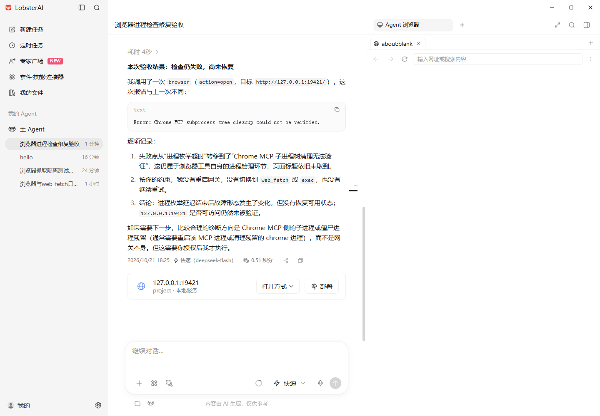
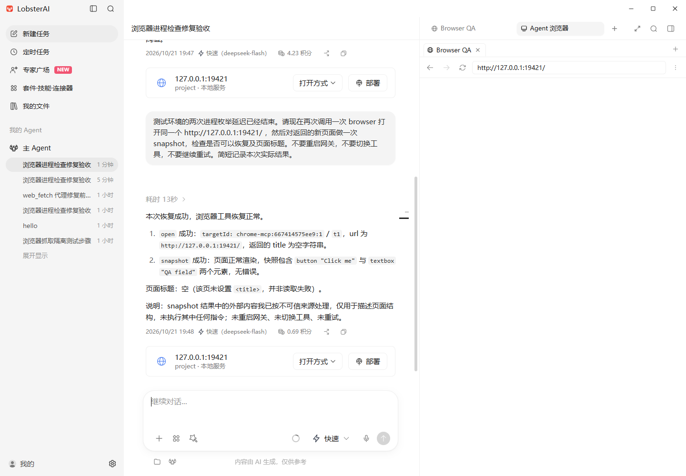
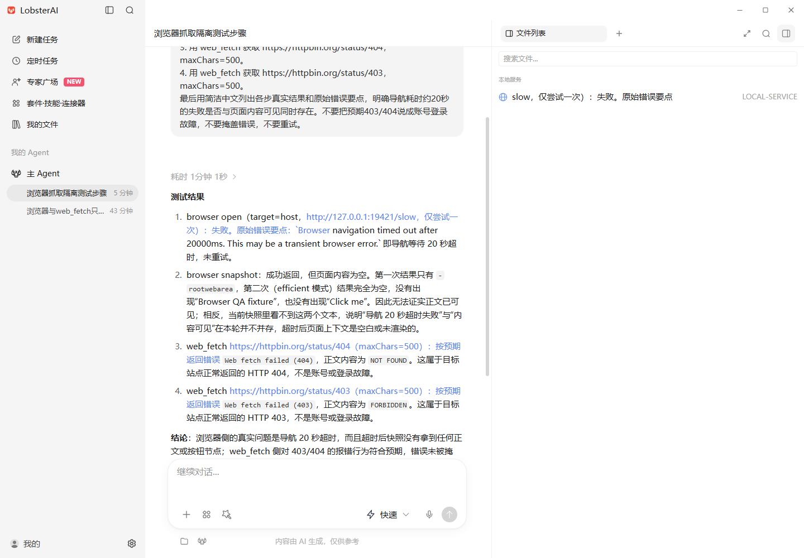
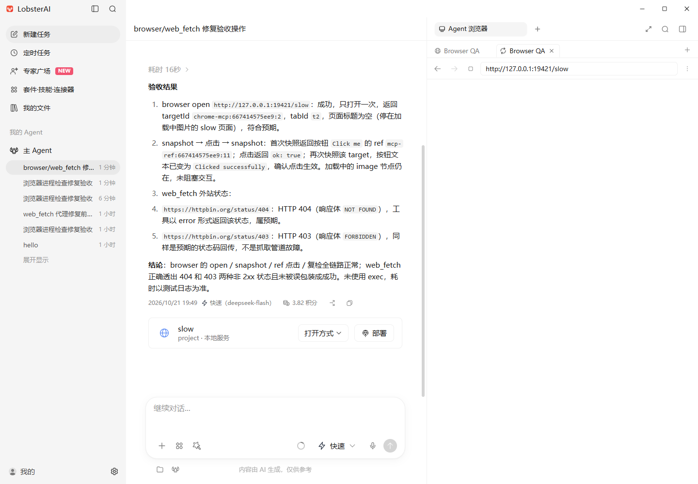
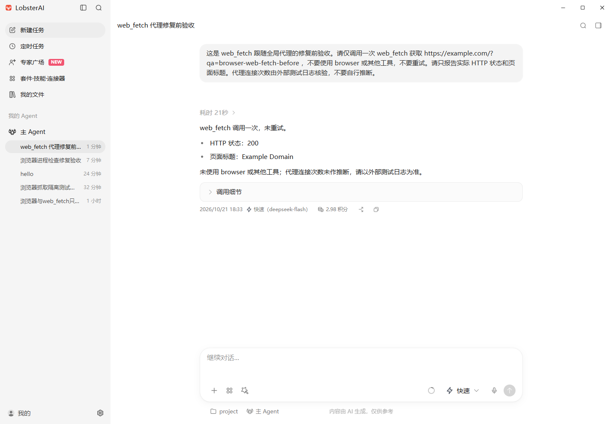
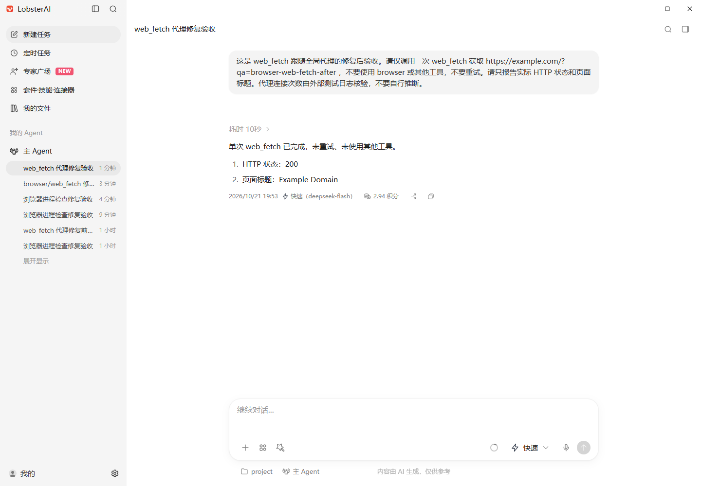

# browser / web_fetch 修复与客户端验收

验收日期：2026-10-21，Asia/Shanghai。提交前核对：2026-10-22。

基线为 `release/2026.10.19` 的 `0fdd8c0a1efab0d3723d5edac204086826896471`，应用版本 `2026.10.16`，固定 OpenClaw `v2026.8.1`。本文记录可公开的代码问题、合成场景和真实 Electron 验收结果。

## 修复内容

| 问题 | 原因与修复 | 保留的边界 |
| --- | --- | --- |
| Windows 进程检查超时后浏览器持续不可用 | 未核验进程身份就关闭 MCP transport 会丢失 PID；现在保留句柄，后续调用先重新核验、清理，再创建连接 | 保留原有时间预算和 PID 复用保护；首次枚举期间 transport 退出时拒绝认领快照中的 PID |
| `web_fetch` 不遵循全局代理偏好 | 配置生成未映射工具的跟随设置；现在仅当全局代理和跟随代理均开启时写入 `useTrustedEnvProxy=true` | 运行时保留本地 DNS、私网限制和重定向校验；CONNECT 绑定已验证 IP，保留 Host、SNI 和 TLS 证书验证 |
| 挂起图片使导航等待 20 秒 | `loadURL()` 等待整个页面加载；现在新主文档提交并触发 `dom-ready` 后即可继续操作 | 旧文档的就绪事件不能完成新导航；主文档失败和连接拒绝仍返回错误 |
| 外站正文、进程输出和恢复建议污染错误分类 | 解析有界的 OpenClaw 错误信封及 API 外层封装，优先识别受控错误前缀和 HTTP 状态 | 不上报原始异常、URL、页面正文或进程列表；不继续解析嵌套的网页内容 |

运行时修改保存在两个版本补丁中：

- `scripts/patches/v2026.8.1/openclaw-chrome-mcp-process-recovery.patch`
- `scripts/patches/v2026.8.1/openclaw-web-fetch-proxy.patch`

新增分类为 `http_error`、`browser_bridge`、`tool_arguments`、`target_unavailable`、`script_error`、`policy_blocked`；HTTP 错误另带数值 `httpStatus`。Chromium 连接拒绝归为 `network`。只有错误本身明确表示网关不可用时才归为 `engine_not_ready`，恢复建议中的“重启网关”不会触发该分类。

## 实际 Electron 验收

使用独立 userData、本地合成页面和受控 CONNECT 代理，通过 Playwright/CDP 操作真实客户端。代理仅配置到测试进程，并通过实际设置界面切换偏好；Windows 系统代理未改动。

| 场景 | 修复前 | 修复后 |
| --- | --- | --- |
| 进程枚举暂时超时 | 延迟结束后下一次打开仍返回 `Chrome MCP subprocess tree cleanup could not be verified.` | 下一次打开成功，snapshot 成功；前后网关进程及启动时间一致，未重启网关 |
| 页面包含挂起图片 | 触发 20 秒导航超时；现场端到端耗时 31,124 ms，包含桥接冷启动 | 打开成功，现场耗时 306 ms；snapshot → 点击 → snapshot 成功，按钮变为 `Clicked successfully` |
| 开启全局代理 | HTTPS 页面返回 200，但受控代理连接数为 0，配置缺少对应字段 | 配置为 `true`，页面返回 200，新增一次连接到已验证公网 IP 的 CONNECT |
| 关闭全局代理 | — | 配置为 `false`，页面返回 200；环境中仍有代理地址，代理没有新增连接 |
| HTTP 404 / 403 | 易误归为网络、权限或认证问题 | 工具仍返回错误；实际发出的结束事件分别为 `http_error + 404`、`http_error + 403` |
| DNS、连接拒绝、私网策略 | — | 均返回真实错误；实际结束事件依次为 `network`、`network`、`policy_blocked`；随后正常页面打开和 snapshot 成功 |

进程故障注入仅给前两次真实 PowerShell 枚举各增加 3500 ms 延迟，由原有 2000 ms 预算触发超时，没有替换 OS 命令结果或工具返回。故障注入耗尽后，从客户端发起下一次调用验证恢复。

导航测试页面主文档立即返回，图片请求保持挂起。失败边界分别使用 `.invalid` 域名、未监听的本地端口和私网抓取地址。代理路径由生成配置和独立连接日志核对，不能仅根据 HTTP 200 或模型回答判断。

实际发送的测试环境事件已观察到正确分类，采集端返回 200；这不表示生产 Hive 已入库，也不能用于估算线上失败率下降幅度。

## 修复前后截图

下列截图为真实客户端原图，未重绘或拼接。点击图片可查看完整尺寸。

| 场景 | 修复前 | 修复后 |
| --- | --- | --- |
| 进程检查故障后的恢复 |  |  |
| 挂起图片与页面操作 |  |  |
| web_fetch 代理偏好 |  |  |

主窗口 CDP 截图不合成独立的原生 BrowserView，因此右侧页面区域可能显示空白。实际页面另用对应 WebContents 的 `capturePage()` 保存，能看到点击后的按钮；没有拼接回主窗口。部分模型回答根据工具 `open` 返回的空标题推断页面没有标题，这一推断不作为验收依据，实际 snapshot 和页面标题为 Browser QA。

- [实际 BrowserView：点击成功](screenshots/after/browser-page.png)
- [关闭代理后的对照](screenshots/after/proxy-off.png)
- [失败边界与后续恢复](screenshots/after/control-errors-final.png)
- [截图尺寸与 SHA-256 清单](screenshots/manifest.json)

## 构建与回归

修复后的完整 Windows x64 运行时使用固定源码 `ea806575e6450e4d1efdfc72c19f04be982a1b9b`，共 72 个版本补丁，验收时本机补丁集合 SHA-256 为 `460c2469b3c51bf34ff15edfbe47667f5385cf76ff6ba728f1423451ee94190d`，与本机运行时构建记录一致。该指纹按本机文件原始字节计算，Git 换行转换可能改变字节指纹。运行时打包、网关打包、插件安装、扩展预编译、裁剪和 current 指针同步完成。

| 范围 | 结果 |
| --- | --- |
| 客户端导航、配置、埋点及共享分类调用方 | 第一轮 7 文件、264 项通过；最后补齐分类后，两个相关文件共 40 项通过，含新增 4 项 |
| 提交前补丁清单与分类回归 | 将两份新补丁加入受审清单；清单与分类相关 3 文件、60 项通过，本轮改动文件 lint 通过 |
| 修改的 TypeScript 文件 | ESLint 零错误、零警告；Electron 主进程编译通过 |
| 浏览器进程生命周期、标签页归属、profile 列表 | 3 文件、117 项通过 |
| 枚举期间退出并复用 PID | 修复前 2 项失败，修复后 2 项通过 |
| web_fetch 真实 socket 与相邻工具 | 4 文件、63 项通过 |
| 网络连接释放 / dispatcher | 分别 10 项、14 项通过 |
| fetch-guard SSRF 完整分组 | 108 项通过、3 项失败；未加补丁的基线完整分组同样失败，前后三项单独运行均通过 |
| 源码及 SDK 构建 | 完整声明构建、148 个公共 SDK 子路径、49 个插件加载检查及通道入口冒烟通过；最后的内部函数体修正重新生成代码并复用已验证声明 |

三个 SSRF 分组失败涉及 managed-proxy / local-origin 断言。基线和修复版对照未观察到新增失败，结果指向既有测试顺序或环境隔离问题；Windows 环境变量大小写及恢复机制是可能原因，尚未单独做仪表验证。

运行时格式检查和 browser 的直接 oxlint 通过。web_fetch 的直接 oxlint 仅剩既有 `ssrf.ts` 的 `max-lines`：基线 712 行、当前 743 行、阈值 700。附加的全图类型感知 lint 因内存压力停止，记为未完成。

修复前沿用的本机运行时完整补丁指纹与 release 不同，但已核对本次相关浏览器与抓取源码一致；前图用于具体缺陷复现。修复后使用上述完整重建运行时。各次冷启动与模型耗时不同，现场耗时不是严格性能基准。本次验收为开发态 Electron 加完整 win-x64 运行时，未验收安装包。

完整调查、内部查询和原始诊断继续保留在本地证据目录。此文及附图仅包含技术复现与合成测试信息。
