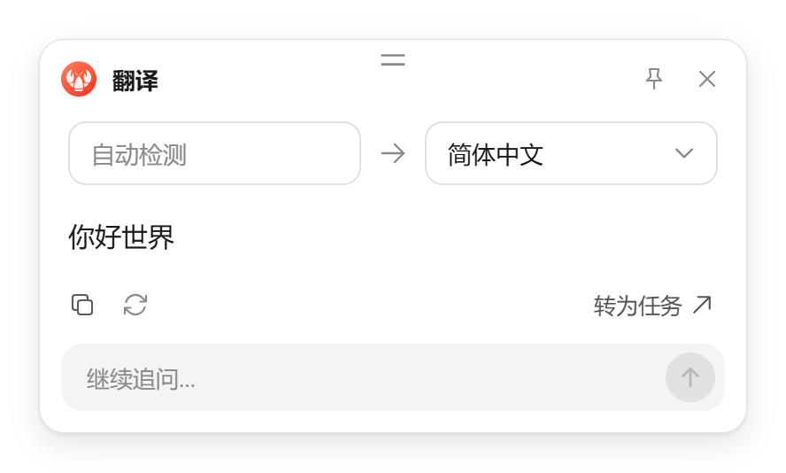
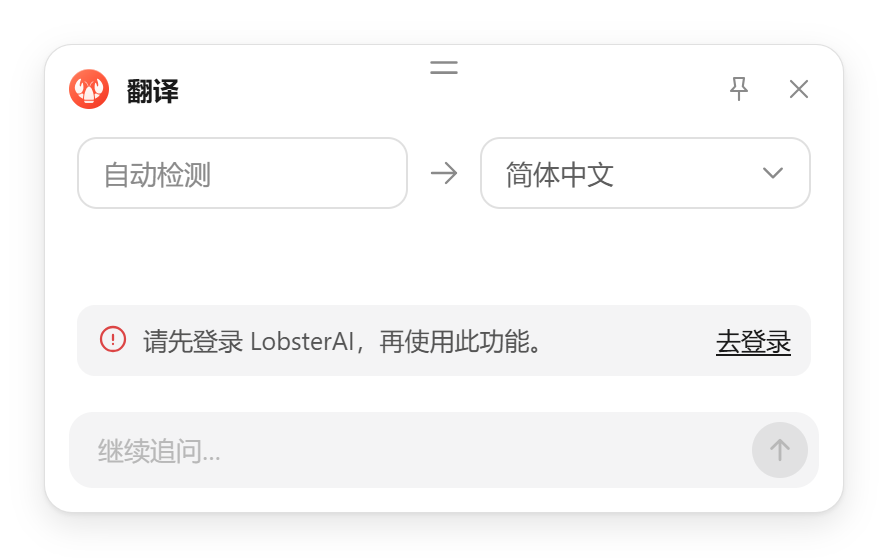

# 悬浮窗翻译登录策略切换设计文档

## 1. 概述

### 1.1 问题/背景

悬浮窗翻译默认支持未登录使用。服务侧需要能够根据运营和风险情况恢复登录要求，端侧需展示清楚的登录引导，而不是把认证拒绝提示为功能暂不可用。

### 1.2 目标

服务要求登录时，沿用现有「去登录」入口；允许匿名时，新请求继续翻译。保留账号和设备独立额度、其它工具的登录校验，以及已有登录状态刷新流程。

## 2. 用户场景

### 场景 1：服务恢复登录要求

**Given** 用户尚未登录，服务端已要求翻译必须登录。

**When** 用户从悬浮窗发起翻译。

**Then** 停止等待译文，显示现有登录引导；点击「去登录」进入原登录流程。

### 场景 2：服务恢复免登录

**Given** 先前翻译因登录要求被拒绝，服务端随后允许匿名翻译。

**When** 用户重新选词或重新打开翻译窗口。

**Then** 新请求重新按当前策略执行，无需重启客户端或先登录。

## 3. 功能需求

### FR-1：认证拒绝必须引导登录

翻译和配额请求识别服务端认证拒绝，并统一为现有端内登录错误。不能因当前用户未登录而改成普通不可用错误。

### FR-2：保持既有登录和错误处理

复用已有登录提示组件、登录入口和中英文文案；原有朗读、总结和追问的认证要求保持不变。已登录请求不能在认证失败后自动消耗设备匿名额度。

### FR-3：策略可恢复

不缓存永久的匿名禁用状态。服务端恢复允许后，新请求可以继续翻译。已有登录提示窗口通过重新选词或重新打开触发新请求。

## 4. 实现方案

`CompanionLanguageClient` 在主进程归一化服务端认证拒绝，同时兼容无结构化错误正文的情况。配额查询保留已有错误隔离逻辑，不用后台查询失败覆盖已展示的成功译文；实际翻译错误进入 `useLanguageTools` 的状态流，由 `LanguageToolsSurface` 显示 `SelectionLoginRequired`。

复用现有 UI 和登录流程，不增加设置项、策略缓存或后台轮询。恢复免登录不会主动替换一个已经打开的登录提示；新的翻译请求会重新判断。

## 5. 边界情况

| 场景 | 处理方式 |
| --- | --- |
| 匿名翻译收到登录要求 | 显示登录提示和「去登录」 |
| 认证错误正文不完整 | 仍识别认证拒绝，避免展示普通网络错误 |
| 已登录认证失败 | 保持原认证流程，不自动转成匿名请求 |
| 配额查询失败但已有译文 | 不覆盖成功译文 |
| 服务恢复免登录 | 重新选词或重新打开翻译，新请求可恢复 |
| 其它工具要求登录 | 保留原行为，不随翻译策略放开 |

## 6. 涉及文件

| 文件 | 改动 |
| --- | --- |
| `src/main/desktopCompanion/languageToolClient.ts` | 认证错误统一转换，兼容错误正文缺失 |
| `src/main/desktopCompanion/languageToolClient.test.ts` | 登录拒绝、额度查询及匿名恢复回归 |

## 7. 验收标准

1. 默认匿名翻译继续成功。
2. 服务要求登录时，实际翻译请求触发现有登录引导。
3. 服务恢复免登录后，新请求能够再次返回译文。
4. 认证拒绝不触发重复请求或偷偷转用另一身份。
5. 相关轻量单元测试及改动文件静态检查通过。

### 7.1 自动化验证记录（2026-10-15）

相关 Vitest 30 项通过，两个改动 TypeScript 文件 ESLint 零警告。

```powershell
npm test -- languageToolClient quickAnswerService speechQueue --maxWorkers=1
```

### 7.2 实机验收记录（2026-10-15）

Windows 下完成 Electron 主进程编译及渲染页面生产构建，通过独立用户目录运行实际 Electron，连接本地测试服务，使用真实翻译能力。通过调试通道操作窗口，不使用系统键鼠自动化。

| 场景 | 实测结果 |
| --- | --- |
| 默认未登录翻译 | `Hello world` 返回「你好世界」 |
| 运行期间要求登录 | 新翻译显示「请先登录 LobsterAI，再使用此功能。」和「去登录」 |
| 点击「去登录」 | 实际打开现有门户登录页面；原登录入口正常 |
| 已登录翻译 | 隔离测试账号返回「早上好」，账号额度独立累计，设备额度不变 |
| 退出登录 | 设备标识不变，仍要求登录时继续展示登录提示 |
| 运行期间恢复免登录 | 不重启客户端，新翻译返回「欢迎回来」，继续累计原设备额度 |
| 其它功能 | 朗读窗口仍展示登录引导；总结、解释、润色和追问仍被主进程登录校验拦截 |
| 每日限额 | 隔离数据预置到边界后，第 1000 次成功，第 1001 次展示次数用完及次日重置提示 |
| 操作频繁 | 展示「操作有些频繁，请稍等一分钟再试。」；等待窗口自然过期后，点击「重试」成功返回译文 |

```powershell
npm run compile:electron
npm run build
```

以上构建均通过。截图和本地验收记录保存在忽略目录 `sandbox/translation-login-policy-acceptance/`，验收实例与临时数据已清理。

验证边界：文本通过实际预加载桥进入悬浮窗，按钮在真实窗口中点击；未覆盖操作系统原生划词。登录按钮已验证到门户页面，账号状态通过隔离测试账号的实际认证交换建立，未提交真实个人账号的交互式登录。

匿名翻译：



需要登录时：


